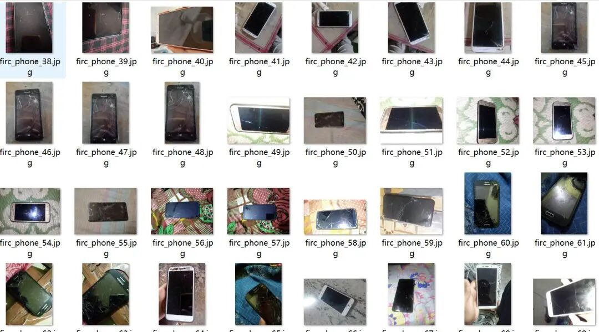
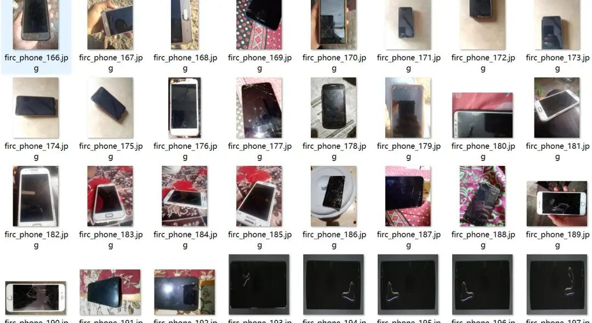
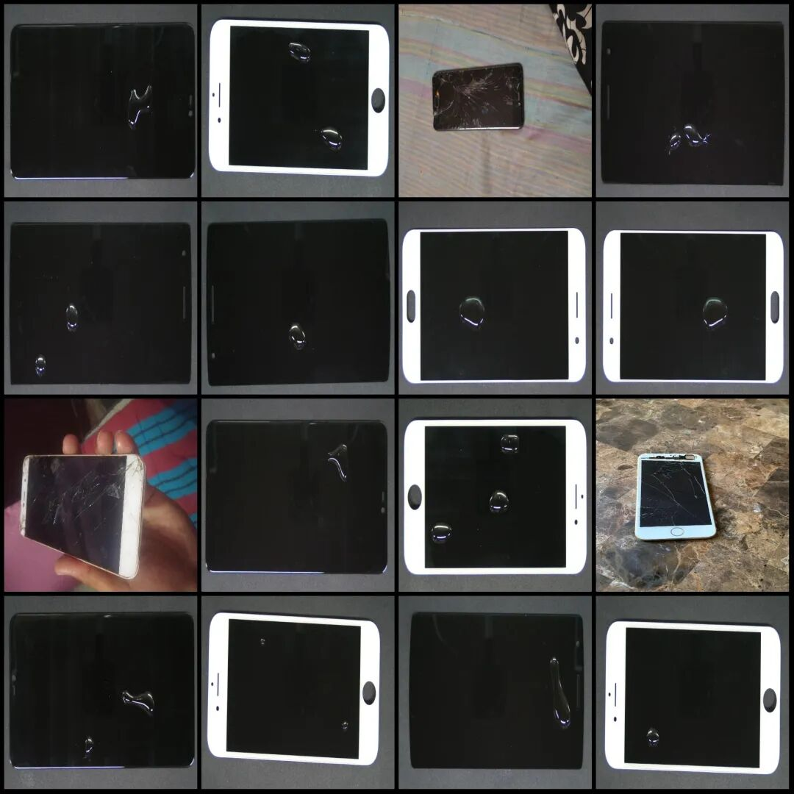
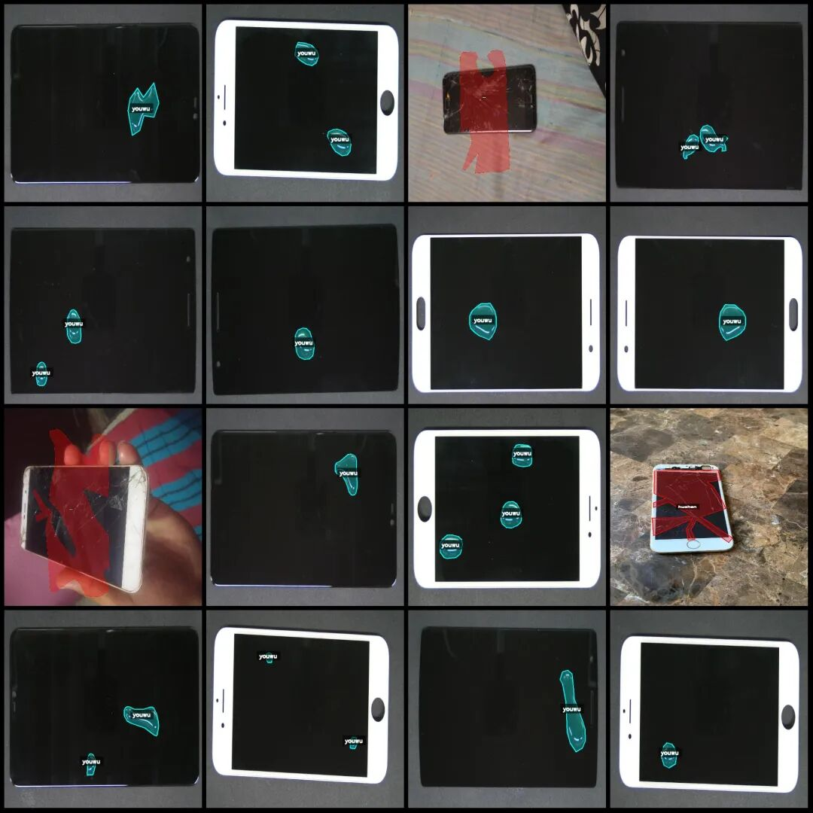
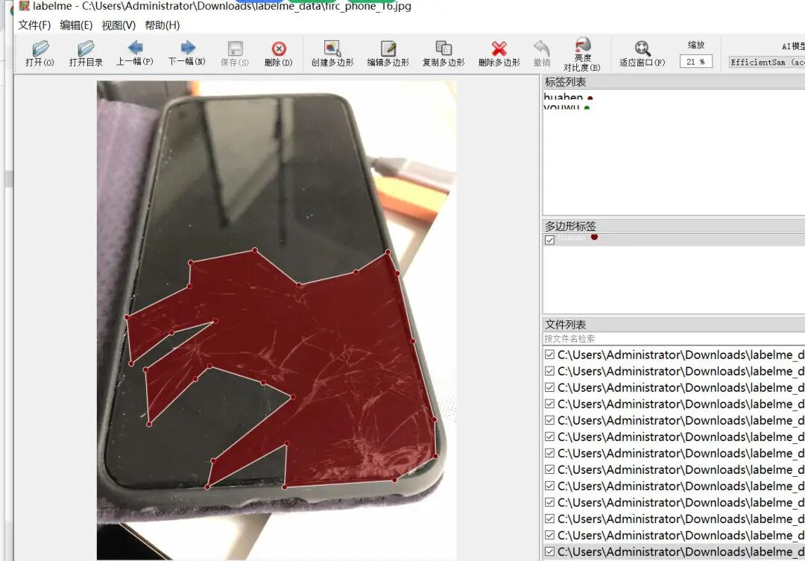

# Smartphone Screen Defects, Oil Stain, Scratch Identification and Segmentation Dataset - LabelMe Format: 1091 images in 2 categories

Dataset format: labelme format (without mask files, only including jpg images and corresponding json files)

Number of images (number of jpg files): 1091

Number of annotations (json file count): 1091

Labeling category count: 2

Label category names: ["huahen", "youwu"]

Number of boxes labeled in each category:

huahen (scratch) count = 377

youwu (oil slick) count = 1235

Total frame count: 1612

Using labeling tool: labelme=5.5.0

Image resolution: 640x640

Annotation rules: Draw polygons around the categories.

Important Notice: The dataset can be opened and edited using LabelMe. For JSON datasets, one must convert them into mask or Yolo formats for semantic segmentation or instance segmentation.

Special : This dataset does not guarantee the accuracy of the trained models or weight files.

Image Preview:

Annotation example:

Original image (pick 16 randomly):

Annotation:

LabelMe editing example:

## Payment

Here is a pay link on Stripe ( https://buy.stripe.com/3cs8yP7sY87d0vu9AB ). Please contact me lonlonago@foxmail.com after funding $89, and I will send you a complete data files , thank you!

